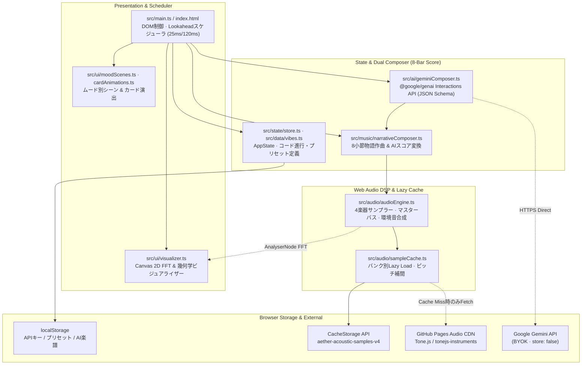
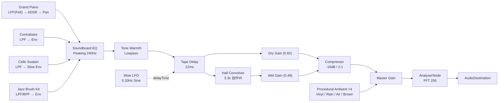

# NOUS // Aether Lofi Radio v4.0

ブラウザだけで動作する、実録アコースティック・ピアノサンプラー＆生成AIジャズ作曲ラジオです。  
バックエンドサーバーを持たない完全クライアントサイド構成（SPA）で、一度読み込んだ実録楽器サンプルを `CacheStorage` に永続キャッシュし、オフライン環境でも再生できます。

**Live Demo:** https://shnakajima.github.io/lofi-radio/

---

## 主な特徴

- **実録アコースティック・サンプラー（Lazy Load + オフラインキャッシュ）**
  - Salamander Grand Piano（18音域）、Contrabass Pizzicato（9音域）、Chamber Cello（5音域）、Jazz Brush & Feather Kit（5種）の計 37 サンプルを、選択したムードに必要なバンクだけ遅延ロードします。
  - 取得した MP3 はブラウザの `CacheStorage`（`aether-acoustic-samples-v4`）に保存され、2回目以降はネットワーク不要でデコードされます。ヘッダーから全バンク一括キャッシュも可能です。
  - 最近傍サンプルを選択し、`playbackRate = 2^((targetMidi - rootMidi) / 12)` でピッチ補間再生します。
- **8小節の物語アーク作曲（Algorithmic Composer）**
  - 機械的な連打を避け、`A → A_VAR → B → INTERLUDE` のセクションを巡回しながら、アウフタクト（弱起）、2〜4拍のロングトーン、4・8小節目の完全休符（余白）と左手対話アルペジオを生成します。
  - 25ms 間隔・120ms 先読みの Lookahead スケジューラにより、スウィング・ルバート・4/8小節目末の微細なテンポ伸縮（1.08x）を安定して演奏します。
- **Gemini BYOK AI コンポーザー（任意機能）**
  - `@google/genai` SDK の Interactions API と JSON Schema 構造化出力を使い、情景プロンプトから 8小節のジャズ楽譜を生成してそのまま実録サンプラーで演奏します。
  - ユーザーの API キーはブラウザの `localStorage` にのみ保存され、選択したモデル（`gemini-3.8-flash` / `gemini-3.1-pro-preview` / `gemini-3.5-flash-lite`）をそのまま呼び出します（下位モデルへの暗黙フォールバックなし）。
  - 生成した楽譜はローカル保存され、オフラインでも再演奏できます。API キー未設定でもアルゴリズム作曲と全サンプラーが 100% 動作します。
- **ネイティブ Web Audio DSP & プロシージャル環境音**
  - Soundboard EQ → Tone Warmth LPF → Tape Wow Delay（0.33Hz Sine LFO）→ 自作 3.3秒 Hall Convolver → Soft Compressor のマスターバスをネイティブ Web Audio API のみで構築。
  - Vinyl Crackle / Window Rain / Room Air / Deep Brown の 4 種の環境音は外部ファイルを使わず、5秒ステレオループのノイズとしてメモリ上で合成します。
- **集中（ポモドーロ）タイマー連動**
  - `25m/5m`・`50m/10m`・`90m/15m` のプリセットを備え、休憩フェーズに入るとドラム（ブラシ）を自動ミュートし、音色の高域を抑えた静かなピアノ独奏へ移行します。

---

## ムードプレート（8種）

| Plate | サブタイトル | 編成 |
| --- | --- | --- |
| **Kiki's Bakery Jazz** | 木漏れ日のカフェ・ジャズ | カフェ・トリオ |
| **Amber Archive** | 古書と珈琲のトリオ | カフェ・トリオ |
| **Bygone Summer** | 夏の海辺のピアノとチェロ | ピアノ＆チェロ |
| **Adriatic Twilight** | 夕暮れの港町バラード | カフェ・トリオ |
| **Cobalt Rain** | 雨の窓辺とフェルトピアノ | カフェ・トリオ |
| **Porcelain Nocturne** | 静かな夜のピアノ独奏 | ピアノ独奏 |
| **Obsidian Study** | 深い集中向けの書斎ジャズ | カフェ・トリオ |
| **Hermes Astral** | 夜汽車と星空の室内楽 | 室内楽 |

---

## アーキテクチャ



### Web Audio DSP シグナルチェーン



---

## 技術スタック

| カテゴリ | 採用技術 |
| --- | --- |
| 言語・ビルド | TypeScript 5.7 (Strict) / Vite 6.0 / Vanilla DOM（フレームワーク非依存） |
| スタイリング | Tailwind CSS 3.4 / PostCSS / Autoprefixer |
| オーディオ | Native Web Audio API / CacheStorage API |
| 生成AI | `@google/genai` SDK（Interactions API + Structured JSON Output） |
| グラフィックス | HTML5 Canvas 2D API（`requestAnimationFrame` + `AnalyserNode`） |
| テスト・デプロイ | Playwright E2E（Chromium） / GitHub Actions → GitHub Pages |

---

## ローカル開発・テスト

### 前提条件

- Node.js 20 以上（推奨: Node.js 22）

### セットアップと起動

```bash
npm install
npm run dev
```

開発サーバーが `http://localhost:5173` で起動します。

### コマンド一覧

```bash
npm run typecheck     # TypeScript 型チェック (tsc --noEmit)
npm run build         # プロダクションビルド (dist/ 出力)
npm run preview       # ビルド結果のローカルプレビュー
npm run test:setup    # 初回のみ: Playwright Chromium インストール
npm run test:e2e      # Playwright E2E テスト実行
```

---

## セキュリティ・プライバシー設計

- **BYOK API キー保護**: Gemini API キーはユーザーのブラウザ内 `localStorage` にのみ保存され、アプリ側のサーバーへ送信されることはありません。API リクエスト時は `store: false` を指定しています。
- **XSS 対策**: AI 生成スコアのタイトル・サブタイトルやユーザー保存プリセット名など動的な文字列は、`innerHTML` ではなく DOM API（`textContent`）で描画しています。
- **HTTPS 通信**: 外部サンプル音源・Google Fonts・Gemini API を含め、外部リソースはすべて HTTPS 経由で取得します。

---

## 音源クレジット

実録アコースティック楽器サンプルは以下のオープンソース音源をランタイムで遅延取得・キャッシュして使用しています（リポジトリ内に音声バイナリは同梱していません）。

- **Salamander Grand Piano & Drum Samples**: [Tone.js Audio](https://tonejs.github.io/audio/)
- **Contrabass Pizzicato & Cello Sustain**: [tonejs-instruments](https://github.com/nbrosowsky/tonejs-instruments)
